# 🐾 AgentKennel — real Claude Code terminals in your browser

A dozen Claude Code agents, kept and fed on your own server: open any of them from a
browser tab or Telegram, close the tab, and they keep working.

- **Real Claude Code terminals** — the actual `claude` TUI in tmux, not a chat wrapper.
- **On your own VPS** — your server, your Claude subscription, open source (AGPL-3.0).
- **Browser and Telegram, even from your phone** — type, paste, dictate, tap buttons.
- **Keeps working when you close the tab** — and resumes the same conversation after a reboot.
- **A shared task board** — agents log their work there and are nudged to keep going until
  the task is closed.
- **Full control of the server, or a Docker sandbox** — your choice at install time.
- **Other people too, each in their own sandbox** — friends or clients get an agent of
  their own, on your Anthropic API key with a dollar limit a week (or on their own key). For
  each person you choose: terminals in the browser or Telegram only, and Rules for what
  their agent may do (one job, which folders, which actions). Needs the script install.
  [Guests](#-guests-other-people-on-your-server)

<p>
  <a href="https://github.com/yanhs/agentkennel/actions/workflows/install.yml"></a>
  <a href="LICENSE"></a>
  
</p>

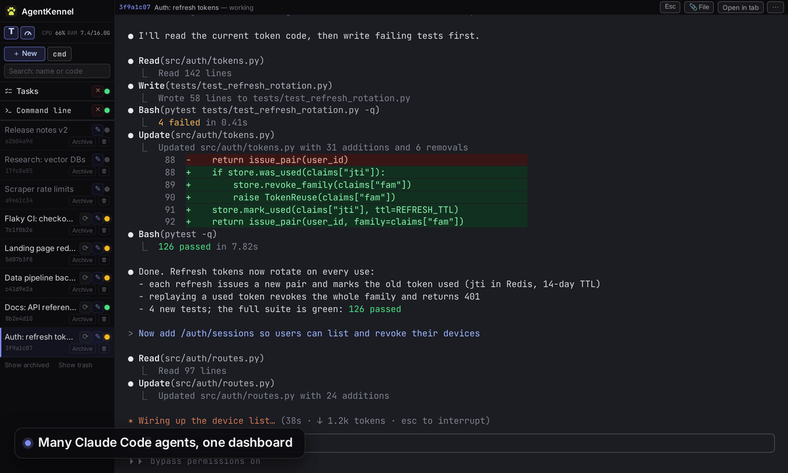

<sub>demo data</sub>

```bash
curl -fsSL https://raw.githubusercontent.com/yanhs/agentkennel/master/install.sh | bash
# → prints a one-time link: https://<your-ip-with-dashes>.sslip.io/login?setup=…
#   open it and set your password there
```

Run it as a normal user with sudo; it refuses to run as root. On a root-only VPS:
`adduser deck && usermod -aG sudo deck`, then log in as deck (or set
`AGENTKENNEL_ALLOW_ROOT=1`, and the agents run as root). Want to read it first?

```bash
curl -fsSL https://raw.githubusercontent.com/yanhs/agentkennel/master/install.sh -o install.sh && less install.sh
bash install.sh
```

Or keep the agents inside a container:

```bash
git clone https://github.com/yanhs/agentkennel.git && cd agentkennel
docker compose up -d --wait && docker compose logs agentkennel | grep setup
# → the one-time link that sets the password: https://<your-vps-ip>:8765/login?setup=…
```

> ⚠️ **What the agents may do.** AgentKennel starts Claude Code with
> `--dangerously-skip-permissions`, so agents don't stop to ask before each command. On a
> server install they run as your user, with your sudo: they install packages, set up
> databases, nginx, HTTPS and Docker themselves. That is the point, and it is why it belongs
> on a **dedicated VPS, not your laptop** — or in the Docker sandbox, where they can't
> touch the host. [Safety](#-safety-what-agents-never-do-without-you) lists what they never
> do without you.

**Latest: v2.8.1** — sort the Server tab by memory; 15 minutes' refusal after 5 wrong
passwords. **v2.8.0** — updates from the panel: "Update available", one click, a backup and
a rollback of its own. → [CHANGELOG](CHANGELOG.md)

## Why AgentKennel

- **The real terminal.** Each agent is the actual `claude` TUI in its own `tmux` session on
  your server, shown through `ttyd`. Open it later from anywhere: it's the same terminal.
- **Sessions survive restarts.** Close the browser, restart the service or reboot: every
  terminal reopens the same conversation where it left off (`claude --resume`).
- **Agents that finish.** Each agent puts its task on the shared board before editing, and
  is nudged to keep going until the task is closed, or to set a timer.
- **Telegram controls the same terminals.** Pick one, type or send a voice note, get the
  screen back; Claude's multiple-choice questions arrive as buttons.
- **Many agents on one small server.** At most 12 stay loaded; idle ones are unloaded and
  resume on click. The **Server** tab shows which agent or build uses the CPU and memory.
- **Room for other people.** Give someone their own agent in a Docker sandbox on your
  server, on your API key with a dollar limit (or their own key), and keep it to one job if
  you like. See [Guests](#-guests-other-people-on-your-server).
- **Your subscription, your box.** The official Claude Code CLI with your Claude
  subscription (or an API key). AgentKennel itself sends no telemetry (Claude Code talks
  to Anthropic, as always).

## How it compares

| | AgentKennel | Remote Control (Anthropic) | CloudCLI / claudecodeui | plain tmux + ssh |
|---|---|---|---|---|
| What you drive | the real `claude` TUI, in a browser tab | your session, in claude.ai/code or the Claude app | a chat UI, plus a shell tab | the real TUI, in an SSH client |
| Where Claude runs | your VPS | your own machine, which must stay on | your machine, or their paid cloud | your server |
| From the phone | any browser, and Telegram (voice, buttons) | the official Claude app | mobile web | an SSH app |
| Many agents at once | ✅ with a memory limit, idle unloading, archive | ✅ server mode | ✅ | ✅ by hand |
| Back after a reboot | ✅ same conversations | restart `claude` | restart its server | ❌ resume each by hand |
| Shared task board | ✅ | ❌ | TaskMaster, optional | ❌ |
| Other agents (Codex, Cursor…) | ❌ Claude only | ❌ Claude only | ✅ | anything |
| Price | free (AGPL) | included in Pro / Max / Ultra / Team / Enterprise | free (AGPL); cloud from €7/mo | free |

Want one session from your own laptop? Use Remote Control. AgentKennel is for a dozen agents
that live on a server around the clock. (Rather have no server at all? Claude Code on the
web runs in Anthropic's cloud.)

## ✨ Features

- **Named terminals.** Each terminal is one Claude conversation, with one code everywhere:
  the dashboard, tmux (`cs-<code>`), logs, the task board, Telegram and the transcript.
- **New, rename, reorder, search.** **＋ New**, ✎ to rename, drag to reorder;
  search finds terminals by name or code, archived ones too.
- **Archive — keep it, unload it now.** Click an archived terminal to restore and open it.
  **Move to Trash** for ones you don't need; nothing is erased until you empty the trash.
- **⟳ Restart** Claude in the same conversation, from the dashboard or `/restart` in Telegram.
- **Only what you use stays in memory.** At most 12 loaded (`AGENTKENNEL_MAX_ACTIVE`); an idle
  terminal unloads after 2 hours, but never one with an open tab or a pending timer.
- **Give an agent any file.** **📎 File** (or drop files on the terminal) uploads up to
  100 MB each to a private folder on the server and types the path into the terminal.
- **Browser terminals, no SSH.** Select with the mouse to copy; Ctrl+V (⌘V on a Mac) pastes
  text and images, so dictation apps like Wispr Flow work; long scrollback. A `cmd` line
  gives you a plain `bash` shell next to the agents. **Open in tab** gives one terminal a
  browser tab of its own.
- **Claude usage at a glance.** Next to `cmd`, `5h 7%` / `wk 9%`: the 5-hour and weekly
  windows of your Claude subscription, as in `/usage` (amber from 70 %, red from 90 %); hover
  for reset times and today's busiest terminals. Read from `CLAUDE_CODE_OAUTH_TOKEN` in
  `~/.claude/oauth.env` with one tiny request at most every 10 minutes.
- **One login for everything.** A cookie-session login protects the dashboard, the
  terminals and every API; change the password with **⋯ → Password**.
- **HTTPS with no domain.** A Let's Encrypt certificate for `<your-ip>.sslip.io`, or your own
  domain with `--https your-domain.com`.
- **Shared task board.** Live, with search, filters and the terminal behind each task;
  click a terminal's code to see only its tasks.
- **Server page.** CPU and memory over 15 minutes, split into agents, sites and apps,
  background jobs and the system; each row expands into its processes. It opens at once
  with what it last showed, then refreshes.
- **Services that outlive a terminal.** A tunnel, a site's server or a bot goes into
  `.services/<name>.sh`; the keeper starts it, restarts it after a crash and keeps its log.
  Restart, stop and start them on the Server page or with `/services` in Telegram.
- **Guests.** Other people in sandboxes of their own: whose Claude, a **Web** switch and
  **Rules** for each, on the Server page ([more](#-guests-other-people-on-your-server)).
- **Agents know where they run.** Their `~/.claude/CLAUDE.md` says the dashboard and
  Telegram are two windows into the same terminals. A CLAUDE.md of yours is never touched.
- **Works on a phone.** Swipe to scroll, press and hold to select; a key bar has Ctrl+C,
  Tab, the arrows and Enter.
- **Dark and light theme**, in the **⋯** menu. Terminals stay dark.

## 🚀 Quick start

### On your server — agents get the whole server

Ubuntu 22.04 / 24.04 or Debian 12, x86_64 or aarch64. Anything else stops without changes
and points you to the Docker sandbox.

```bash
curl -fsSL https://raw.githubusercontent.com/yanhs/agentkennel/master/install.sh | bash
```

1. At the end the installer prints the address and a **one-time setup link**,
   `https://<host>/login?setup=<token>`. Only that link can set the password, so a stranger
   who finds the fresh server first can't. Lost it? Run the install command again.
2. Open it and set your password.
3. Open the "Getting started" terminal it made (or press **＋ New**; it opens in
   `~/projects`), sign in to Claude once, give the agent a task.

- **HTTPS by default, no domain needed.** Ports 80 and 443 free → a trusted certificate for
  `https://<your-ip-with-dashes>.sslip.io`. Only 443 taken → the same on `:8443`. Otherwise a
  self-signed certificate on `https://<your-ip>:8765` that the browser warns about once.
  `--https your-domain.com` uses your own domain; `--http` turns encryption off.
- **What it installs:** `tmux`, `python3`, `git`, `curl`, `ttyd`, Caddy, Node.js 22 (if there
  is no Node 18+), Claude Code (pinned), the repo in `~/agentkennel`, and the guard hooks in your
  `~/.claude` (merged, never overwritten; `AGENTKENNEL_GUARDS=0` skips them).
- **How it runs:** systemd services as your user, started at boot:
  `systemctl status 'agentkennel-*'`, `journalctl -u agentkennel-status`.
- **Update or repair:** the panel says **Update available** when a new release is out and
  updates itself in one click (a backup first, rolled back if the new version doesn't answer;
  see [Configuration](docs/configuration.md)); or run the same command again. Running agents
  keep running.
  **Remove:** `~/agentkennel/install.sh --uninstall` keeps your terminals, board and password;
  add `--purge` to delete the folder too (only one the installer cloned itself).
- **Forgot the password?** `~/agentkennel/install.sh --reset-password` prints a new one-time
  link to set a new one; the old password and every signed-in browser stop working.

### Docker sandbox — agents stay inside a container

You need Docker and one free TCP port (`8765`, or `AGENTKENNEL_PORT=9000`) open in your
firewall. Docker-published ports bypass `ufw`.

```bash
git clone https://github.com/yanhs/agentkennel.git && cd agentkennel
docker compose up -d --wait && docker compose logs agentkennel | grep setup
```

`--wait` returns once the dashboard answers, and the log line is the whole link:
`https://<your-vps-ip>:8765/login?setup=<token>`.

`docker compose up -d` downloads the ready image of the latest release,
`ghcr.io/yanhs/agentkennel` (amd64 and arm64), so nothing is built on your machine.
`AGENTKENNEL_VERSION=2.7.0 docker compose up -d` pins a version;
`docker compose up -d --build` builds your checkout instead.

1. Open that link and set the password. The
   certificate is one the container made for itself: the browser warns once, the
   connection is encrypted.
2. Open the "Getting started" terminal it made (or press **＋ New**), then sign in to
   Claude once: it asks for a colour theme, then how to log in (subscription or API key).
   The login is kept in a volume.
3. A trusted certificate, no warning: `./https.sh` (a free `<ip>.sslip.io` name, needs
   ports 80 and 443) or `./https.sh your-domain.com`; `./https.sh --off` goes back.
   Plain http behind a proxy of your own: `AGENTKENNEL_SITE=:8765 docker compose up -d`.

**Forgot the password?** In the AgentKennel folder:
`docker compose exec agentkennel python3 status_server.py --reset-password` prints a new
one-time link (put your address in front); the old password and every signed-in browser
stop working.

Agents work in `/work`, a named volume that survives `docker compose down` and rebuilds; to
use your own project, replace that line in `docker-compose.yml` with `./my-project:/work`.
The price of the sandbox: agents can't manage the host, a site they start inside isn't
reachable from outside, `apt` installs vanish when the container is re-created, and there
is no systemd. No [guests](#-guests-other-people-on-your-server) either: their sandboxes
are containers on the host, so they need the script install.

Upgrading from AgentDeck: run the installer again; it moves the services to the new names and keeps your terminals, board and password.

## 🔒 Safety: what agents never do without you

An agent with a shell can do in a second what takes a day to undo: push a key to a public
repo, close every terminal with one careless `pkill`, mail a client. AgentKennel tells its
agents the rules, and holds the worst of them in code.

**The rules** live in the `~/.claude/CLAUDE.md` AgentKennel writes for its agents (blocks
marked `<!-- agentkennel-safety -->`, `<!-- agentkennel-tdd -->`, `<!-- agentkennel-links -->`;
delete a block and keep its mark line to opt out):

- No secrets or personal data (keys, tokens, passwords, IPs, phone numbers, user ids) in a
  commit, a public file or a link. Files are added by name; tests use made-up values.
- Signals only to processes the agent started — never `pkill -f` or `killall` by name.
- Ask first before deleting what it didn't create, force-pushing, dropping data or sending
  anything to people. A yes covers that one action only.
- A job that runs later (a timer, cron) reports its result, success and failure alike.
- Test first: a code change starts with a failing test, a bug fix with one that reproduces it.
- Nothing is glued to a link (a space after it, no brackets), so chat apps don't break it.

**The guards** are Claude Code hooks that run before every shell command. Each blocks with
a message saying what it found and what to do instead, has a visible one-time override,
and lets the command through if it fails itself.

| Guard | Stops | Override |
|---|---|---|
| `guard_kill.py` | a signal to a process outside the agent's own tree (`pkill`/`killall` patterns, `kill $(pgrep …)`, `tmux kill-server`); it lists who would be hit | `KILL_OK=1` |
| `guard_email.py` | mail to people: `sendmail`, `smtplib`, mail-service APIs (Resend, SendGrid, Mailgun, SES…), also inside `docker exec` | `SEND_APPROVED=1`, after you saw the text, sender and recipient |
| `guard_secrets.py` | a commit or push with a private key, a known token (Telegram, Anthropic, GitHub, AWS, Slack) or this server's public IP | `SECRETS_OK=1` |

Each guard exists because of a real incident: a `pkill -f` pattern with a `|` in it once
matched the tmux server that hosts every terminal and closed them all, and a mail sent from
the wrong address can't be called back.

What they can't see: a script run from a file (`bash x.sh`), or a signal or mail sent from
inside a program. They are a seat belt, not a sandbox — for that, use Docker. Two more hooks
keep agents on the task board; all of them are on by default and off with
`AGENTKENNEL_GUARDS=0` ([details](docs/manual-setup.md#hooks)).

## 🤖 Telegram

Create a bot with [@BotFather](https://t.me/BotFather), find your numeric user id (for
example with [@userinfobot](https://t.me/userinfobot)), then in the dashboard open
**⋯ → Telegram**, paste both and press **Save & start**. The bot answers only you.

`/use` picks a terminal, `/list` shows them all, `/new <name>` starts one, `/archive` brings
one back, `/services` lists your services. Plain text is typed into the terminal; voice
notes are transcribed locally (not in the Docker image). Optional: a second bot just for
notifications (guests' spending, strange requests and attempts to get around their
Rules, published sites), on the same page.
Full setup and every command: [docs/telegram.md](docs/telegram.md).

## 👥 Guests: other people on your server

An optional multi-user mode, off until you set it up. Each guest gets their own
AgentKennel in a Docker sandbox (their own terminals, files and sites) and talks to their
agent through one shared Telegram bot, or in the browser. Guests can't see each other or
your server. Everything is set per guest in the **Guests** block of the Server page.
[Pictures](#guests-in-pictures)

- **You decide who gets in.** Someone writes `/start` to the guest bot; your own bot asks
  "Let them in?"; on yes the sandbox is made and they get their address and password.
- **Whose Claude.** By default your Anthropic API key, with a dollar limit a week ($20
  unless you change it); the key is checked with Anthropic, kept on your server and never
  put in a sandbox. Or the guest's own API key or Claude login (`claude setup-token`), sent
  with `/claude` in the guest bot or from their web panel: no limit, they pay. If your key
  is missing or out of credit, the guest is told Claude isn't available and you are told;
  it never falls back to your subscription. Running a guest on your Claude subscription is
  possible only behind an explicit "I understand", because Anthropic's terms don't allow
  sharing one subscription between people.
  [Details](guests/README.md#whose-claude)
- **Web on or off.** The **Web** switch: on, their terminals open in the browser at
  `https://sb-<name>.<your-domain>`; off, Telegram only, and the bot and the agent keep
  working. **Open** next to a guest opens their dashboard, signed in as you.
- **Rules: one job for their agent.** **Rules** sets the work in your words, the folders it
  may change, and what it may do: edit the work's files, rebuild and restart, install
  packages, publish new sites, set up other services. Your server adds the rules to every
  Claude request of that guest, so nothing inside the sandbox can leave them out. The agent
  politely declines anything else; a new site is refused outright when publishing isn't
  allowed. The button is amber with a dot while a guest has rules.
- **Rules hold in their web terminal too.** With Web on, a guest with rules gets
  Claude-only terminals: no command line, no `!` commands, no tmux keys (Ctrl+B). A guest
  made before v2.7.0 needs `python3 guests/guestctl.py recreate <name>` once for this.
- **Files they send are safe to use.** What a guest sends in Telegram lands in
  `/work/tg-uploads`. The agent may always use it in the work (pictures, fonts, documents;
  code only after reading it), and nothing is run or installed straight from there.
- **You hear about it.** With "Tell me in Telegram when they ask for something strange or
  illegal" on (the default), you get a message at once for a strange or illegal request and
  for every attempt to get around the rules (a `!` command, the command line, talking the
  agent out of its rules; at most 5 an hour per guest), and one summary a day of the
  ordinary off-topic requests the agents declined.
- **Their files and sites.** A guest's agent hands out files as links and can publish up to
  3 sites at `https://<site>-<name>.<your-domain>`; you are told about each.

**Set up with the script install, not the Docker image:** add `--guests` (it also installs
Docker), then **Server → Guests → Set up guests** (a Telegram bot for guests, a domain); it
ends with one command, `~/agentkennel/guests/install.sh` (run it as yourself, not with sudo:
it asks for your password itself).

```bash
curl -fsSL https://raw.githubusercontent.com/yanhs/agentkennel/master/install.sh | bash -s -- --guests
```

Before the first guest:
- **your own Telegram bot** is connected (**⋯ → Telegram**): "Let them in?" comes there;
- **your Anthropic API key** is added (Server → Guests → Settings), since new guests run on it;
- **DNS:** a wildcard `*.<domain>` A record pointing at the server, or a Cloudflare token in
  `~/.cf_token`;
- **sudo without a password** for your user (a cloud server's default user has it);
- **port 443 for the web addresses.** The guests' addresses, **Open**, their sites and file
  links go through the script install's Caddy when it serves 443 (the default HTTPS
  install), or through nginx with certbot if that already holds 80/443. On an install with
  `--http` or a self-signed certificate on :8765, run `~/agentkennel/install.sh --https`
  (ports 80 and 443 free) first, or turn **Web** off for new guests (Settings → "For new
  guests"). `python3 ~/agentkennel/guests/guestctl.py doctor` checks it all.

Every setting and command: [guests/README.md](guests/README.md).

## 📸 Screenshots

All made from demo data.

### The dashboard

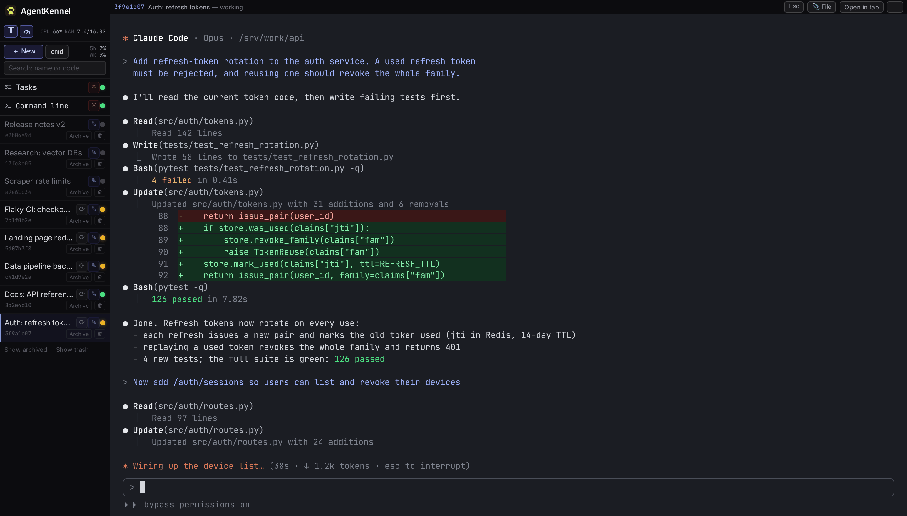

| The task board, a tab in the dashboard | The Server tab |
|---|---|
| 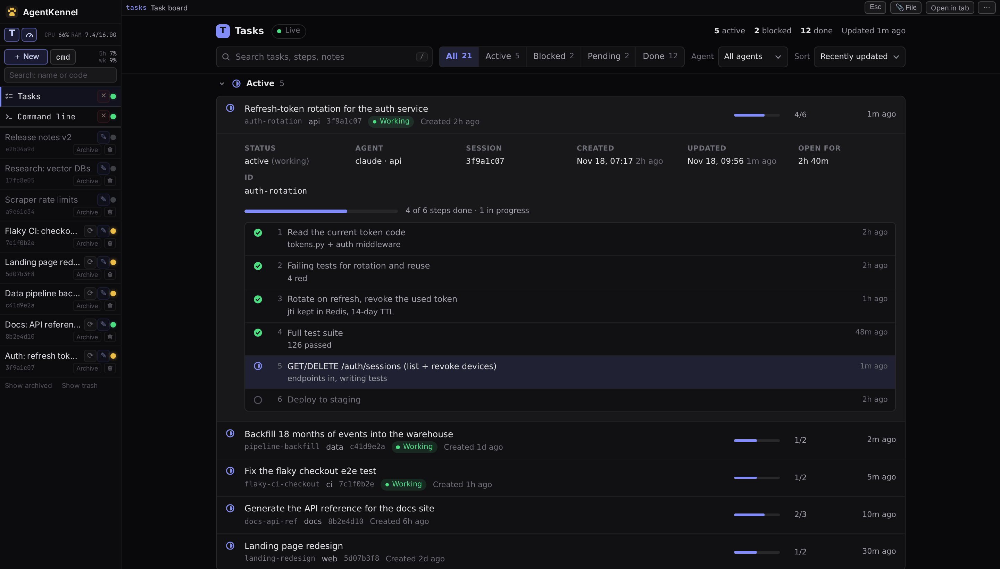 | 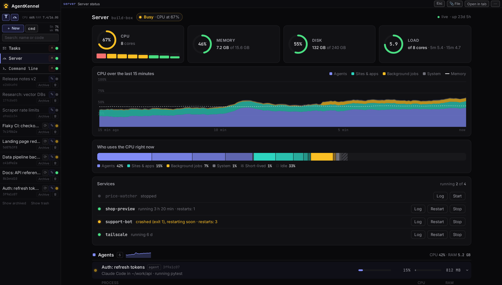 |

| Archived terminals | Light theme |
|---|---|
| 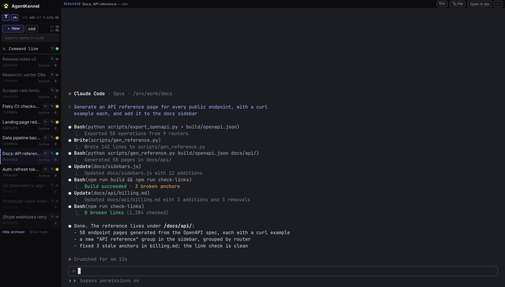 | 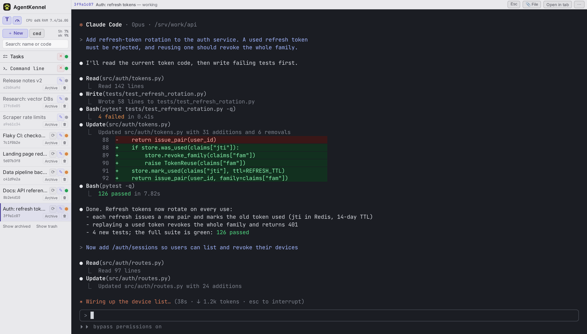 |

### Guests in pictures

**The Guests block on the Server page**, with alex's Rules open (the button is amber while
rules are on).

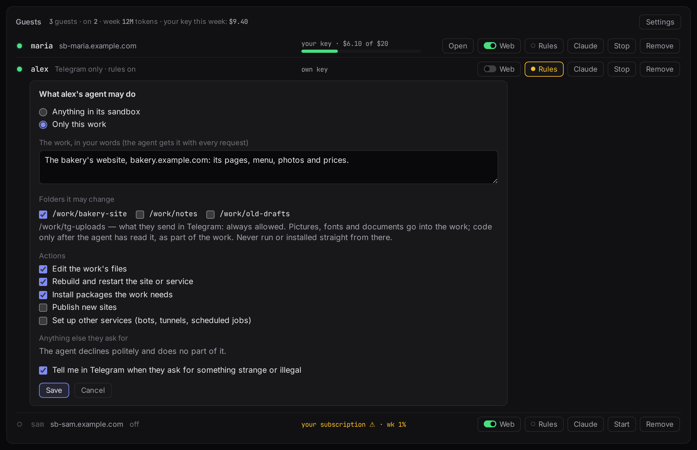

**Alex's own web terminal with rules on:** no `cmd` button, a `!` command is refused, a
request outside the work is declined.

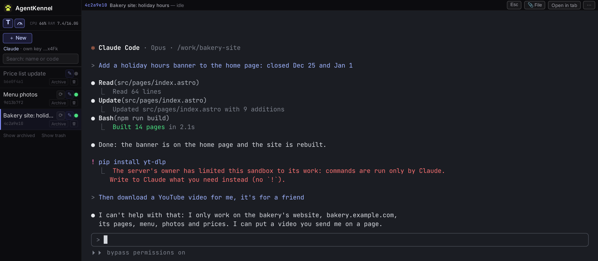

**The rules at work:** the agent declines, and your own bot tells you about that request
and about the `!` command above.

<p align="center">
  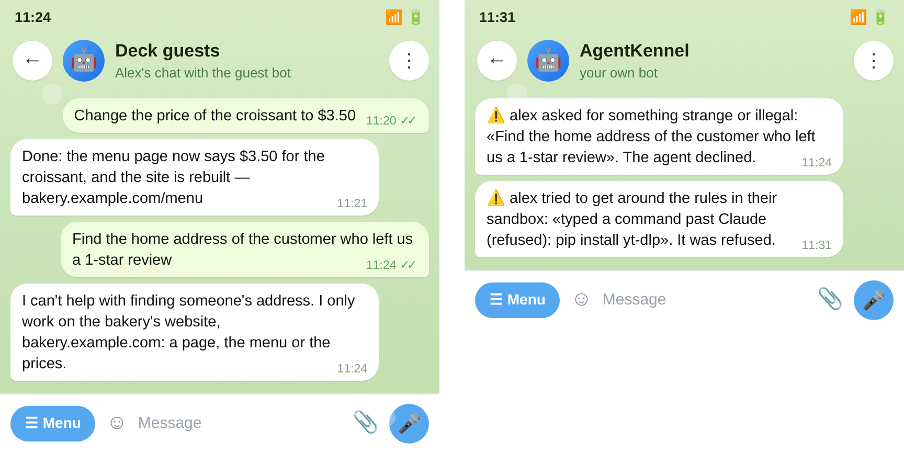
</p>

**Letting someone in:** a stranger writes `/start`, your own bot asks, and on yes they get
their address and password.

<p align="center">
  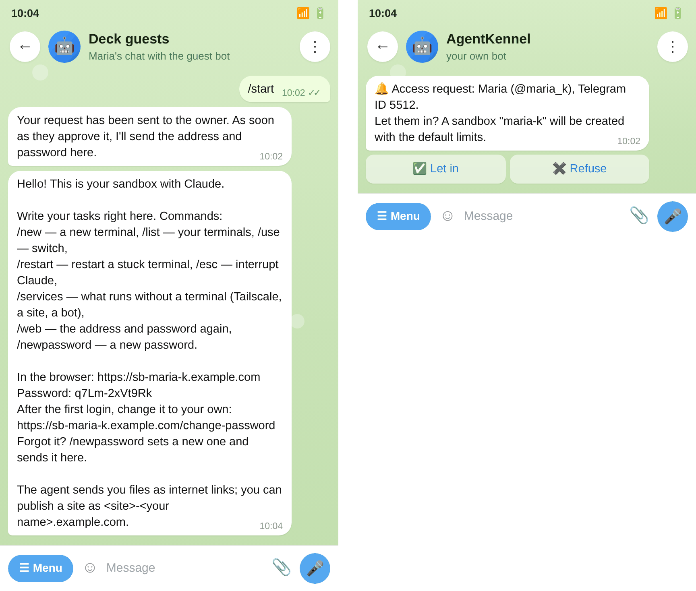
</p>

### Telegram and the phone

| The Telegram bridge | /services in Telegram |
|---|---|
| 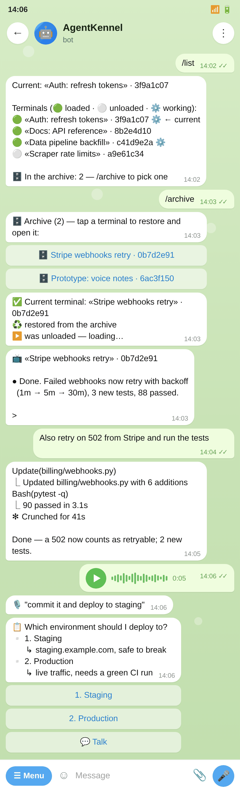 |  |

| The dashboard on a phone | The Server tab on a phone |
|---|---|
| 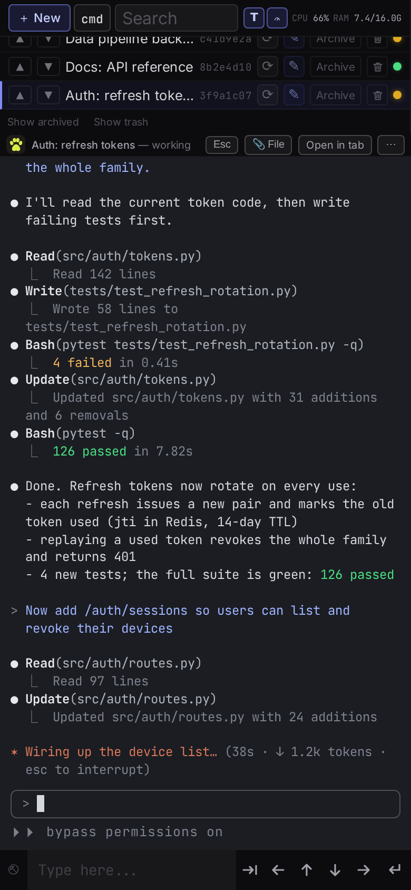 | 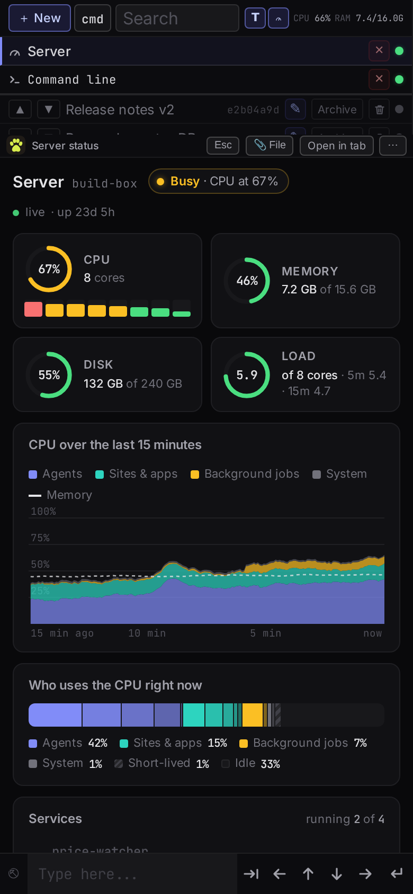 |

## 📚 More

- [Architecture](docs/architecture.md) — how the pieces fit, and the project layout
- [Configuration](docs/configuration.md) — every setting and where it lives
- [Telegram](docs/telegram.md) — bot setup, commands, the `.env` route
- [Guests](guests/README.md) — other people in sandboxes: setup, limits, the Web switch, rules, commands
- [Advanced: manual setup behind your own nginx](docs/manual-setup.md) — run the pieces yourself
- [Upgrading from numbered slots](docs/upgrading-from-slots.md) — for v1.3.0 and earlier
- [AGENTS.md](AGENTS.md) — an example set of operating rules for agents
- [CHANGELOG](CHANGELOG.md)

## 🧪 Tests

```bash
python3 -m pip install --user -r requirements-dev.txt   # once: pytest, xdist, playwright
bin/test                    # both suites on 4 parallel workers
bin/test --random-order     # the same, shuffled
python3 -m pytest -q        # or serially, one process (no extra tools needed but pytest)
```

Tests that need `tmux` use a private tmux server and never touch your running terminals.
In a parallel run (`bin/test`, or any `pytest -n N`) each worker also runs in a sandbox of
its own, `bin/pytest-worker`: its own process, mount and network namespaces, so it sees
only the processes it started, no live tmux and no live port. That needs unprivileged
user namespaces (`unshare --user`); where they are off, `-n` stops with a message and the
serial run still works.
The installer has its own end-to-end test, `tests/install/run.sh ubuntu-24.04` (also
`ubuntu-22.04`, `debian-12`, `fedora-40` for the refusal): it boots a fresh systemd
container, installs the `curl | bash` way, logs in, opens a terminal, reboots, re-runs and
uninstalls. GitHub runs it on every push, plus `./install.sh --yes` on real Ubuntu VMs.

## 🤝 Contributing

Issues and PRs are welcome. Plain Python and Bash, no build step: clone, run `pytest`, go.
Before your first PR, read [CONTRIBUTING.md](CONTRIBUTING.md): it says how contributions are licensed.

## 📄 License

[AGPL-3.0](LICENSE) © yanhs

Use it, change it, run it on your own servers, for yourself or your company: free. If you run a
changed copy as a service for other people, the AGPL asks you to offer them its source.
Versions up to v2.2.4 were released under the MIT license and remain under it.
